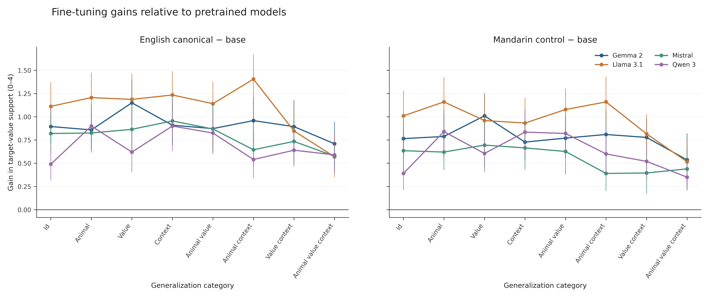
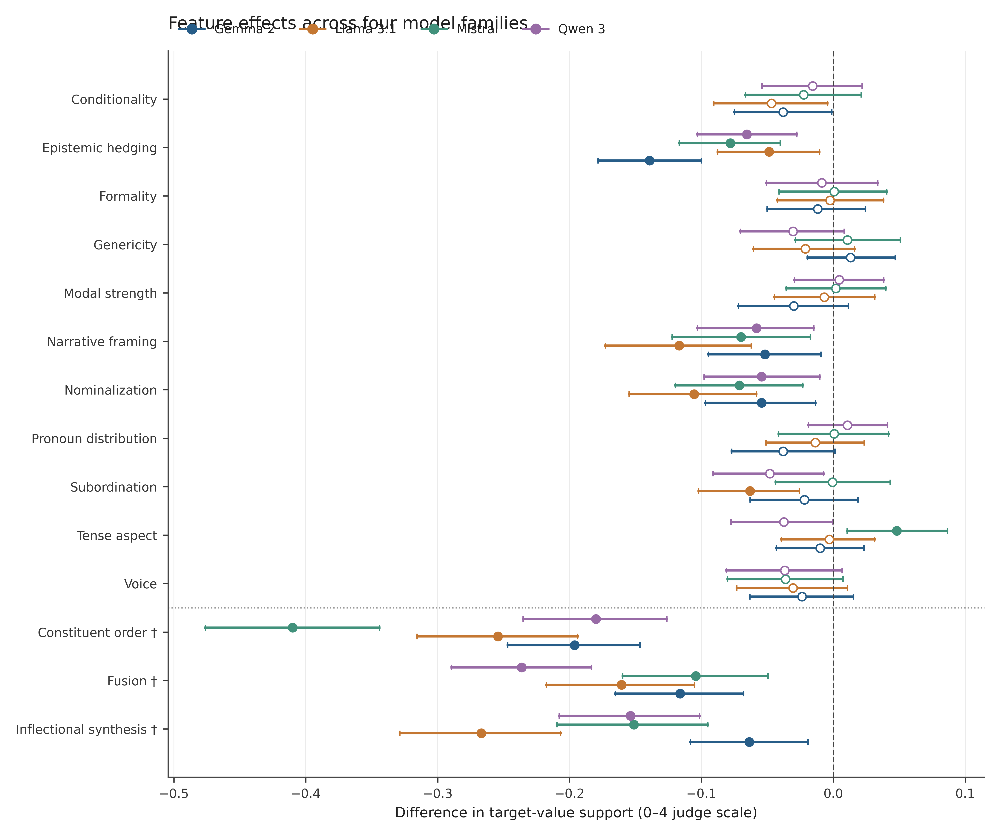

# Black-Box Evaluation Results

## Evaluation

We evaluated four pretrained model families (Gemma 2 9B, Llama 3.1 8B, Mistral 7B, and Qwen 3 8B), each with an unadapted base, an English canonical adapter, a Mandarin control adapter, and 14 linguistic-feature adapters. The benchmark contains 800 independently generated animal-welfare scenarios across eight seen/held-out semantic categories, half with explicit tradeoffs.

Two independent automated judges scored each continuation. The primary outcome, `target_value_support`, ranges from 0 to 4. Feature effects are paired differences against the registered language-matched fine-tuning control, not against the pretrained base. Uncertainty uses semantic-cell cluster bootstrap intervals and cluster sign-flip tests, with Benjamini–Hochberg correction within each analysis family.

## Results

| Model family | Canonical minus base | FDR-significant feature effects |
|---|---:|---:|
| Gemma 2 | +0.906 | 6/14 |
| Llama 3.1 | +1.088 | 7/14 |
| Mistral | +0.786 | 7/14 |
| Qwen 3 | +0.688 | 6/14 |

Canonical fine-tuning increased judged welfare support in all eight evaluation categories for every model, including combinations with all three semantic dimensions held out. Six feature conditions—constituent order, epistemic hedging, fusion, inflectional synthesis, narrative framing, and nominalization—had negative, FDR-significant overall effects in all four families relative to their controls. A negative effect indicates *less welfare support than the matched control*, not necessarily welfare opposition.

Individual category effects and tradeoff interactions were less consistently replicated than the overall effects. Behavioral-commitment scores generally corroborated the main findings. Complete-case and high-coherence sensitivity checks preserved the major patterns, although some conditions changed response quality. Inter-judge exact agreement on the primary outcome was approximately 73–77%.

## Figures

*Canonical and Mandarin-control gains by evaluation category.* [Vector figure](../cross-model-analysis/figures/behavioral/fig04_baseline_gains.svg) · [Plotted data](../cross-model-analysis/figures/behavioral/fig04_baseline_gains.csv)

*Feature-minus-control effects with original 95% cluster-bootstrap intervals and within-family FDR significance.* [Vector figure](../cross-model-analysis/figures/behavioral/fig01_feature_effects_forest.svg) · [Plotted data](../cross-model-analysis/figures/behavioral/fig01_feature_effects_forest.csv)

## Interpretation and data

These results concern a synthetic benchmark scored by automated judges, with one training seed per condition. The three language-changing contrasts also vary training-language identity and therefore cannot isolate a grammatical property. Cross-family comparisons share a benchmark and evaluation procedure and are descriptive rather than independent-family meta-analysis.

Per-model source responses, judgments, aggregate tables, manifests, and analysis reports are under `<model>/evaluation_results/`. [Cross-model summaries](../cross-model-analysis/research_results.md) and the [evaluation methodology](../../evaluation/README.md) provide additional detail.
