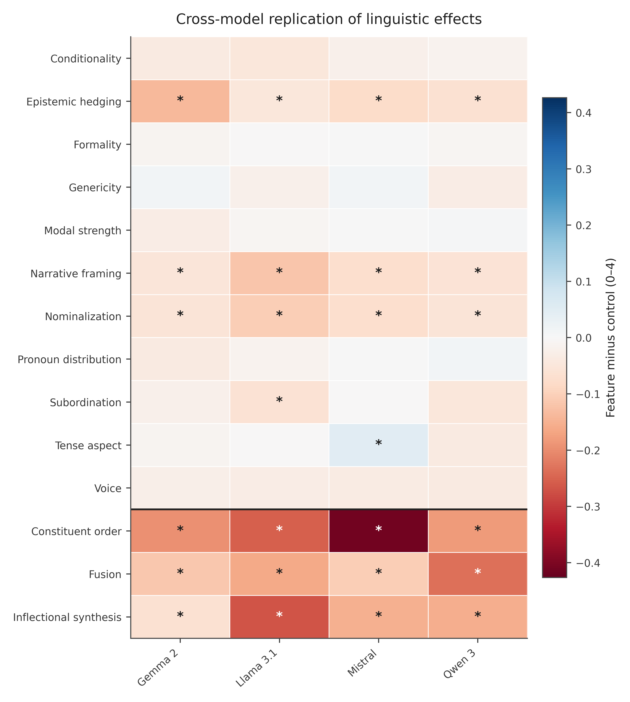
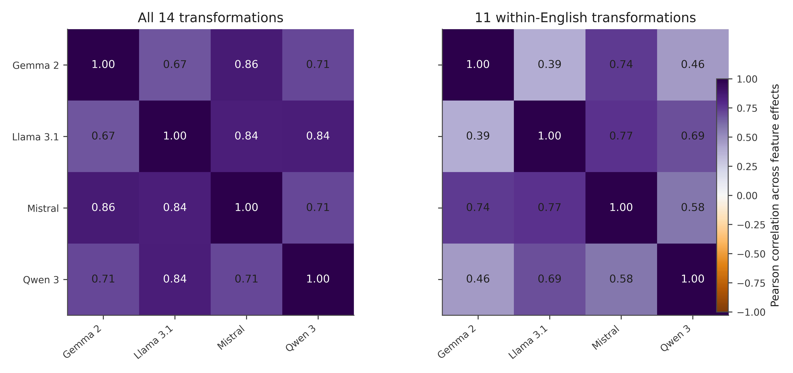

# Cross-Model Analysis Results

## Scope

We compared feature-adapter versus registered-control effects across Gemma 2, Llama 3.1, Mistral, and Qwen 3, using the same animal-welfare evaluation design. The 14 contrasts comprise 11 within-English features and three language-changing features. Primary welfare-support differences are measured on a 0–4 scale, with original within-family clustered uncertainty and FDR adjustment preserved. Cross-family results are **descriptive comparisons**, not independent-family meta-analytic estimates.

## Behavioral replication

Canonical fine-tuning increased welfare-support scores over the pretrained base in all four families (+0.906 Gemma, +1.088 Llama, +0.786 Mistral, and +0.688 Qwen). Mandarin controls also improved scores (+0.773, +0.953, +0.558, and +0.620 respectively).

Six feature conditions produced **negative, FDR-significant overall feature-minus-control effects in all four models**: constituent order, epistemic hedging, fusion, inflectional synthesis, narrative framing, and nominalization. Constituent order, fusion, and inflectional synthesis also change the training language, so they do not independently identify the effect of grammar. Three additional features—conditionality, subordination, and voice—had the same negative point-estimate sign in all four families but did not show four-family FDR replication.

| Comparison | Across the four families |
|---|---|
| Significant primary feature effects per model | 6/14 Gemma; 7/14 Llama; 7/14 Mistral; 6/14 Qwen |
| All-family FDR-replicated features | 6/14 (3 within-English, 3 language-changing) |
| All-family sign-consistent negative features | 9/14 |
| Pairwise Pearson correlation of 14 effect profiles | 0.674–0.861 |
| Pairwise Pearson correlation of 11 within-English profiles | 0.388–0.769 |

The smaller correlations restricted to within-English contrasts caution against overinterpreting agreement driven by language-changing conditions. Subgroup evidence was less uniform: category-specific FDR discoveries occurred in 6, 15, 9, and 12 of 112 tests (Gemma, Llama, Mistral, Qwen), and only the constituent-order effect in the non-held-out category replicated at FDR significance across all four. No tradeoff interaction passed that four-family criterion. Response-quality, high-coherence, and judge-agreement analyses qualify the primary effects but do not erase their principal replicated pattern.

The [full feature-effect table and source-data index](research_results.md) retain all 14 contrasts, including null and mixed-sign results.

## Mechanistic comparison

The normalized dataset includes **658 scalar-result files**, **562,260 records**, **1,090 comparable profiles**, and 1,214 exploratory cross-stage association strata. Mean welfare-prompt representation CKA was approximately 0.97 across the four families, linguistic-condition probe AUC approximately 0.93, and welfare-score probe held-out R² only 0.06–0.13. Final LoRA updates were measurably different from registered controls, while within-training update directions were comparatively stable.

On independently judged held-out activation steering, **five of 112 selected configurations** survived within-model FDR correction: three in Gemma and two in Llama, none in Mistral or Qwen. All five effects reduced judged welfare support. The steering effects do not consistently coincide with the features showing strongest black-box replication. Decodable information, adapter differences, and behavioral effects therefore cannot yet be combined into one established causal pathway. Cross-stage associations are exploratory and uncorrected for the many comparisons.

## Figures

*Per-feature differences against matched controls, by architecture.* [SVG](figures/behavioral/fig02_replication_heatmap.svg) · [Data](figures/behavioral/fig02_replication_heatmap.csv)

*Pairwise effect-profile correlations for all 14 features and 11 within-English contrasts.* [SVG](figures/behavioral/fig03_architecture_correlation.svg) · [Data](figures/behavioral/fig03_architecture_correlation.csv)

Additional figures are indexed in the [detailed results report](research_results.md); see also [behavior–mechanism associations](figures/mechanistic/fig17_behavior_mechanism.svg). Tables and scalar summaries are under `behavioral/`, `mechanistic/`, and `cross_stage_associations.csv`. Generation and comparison code is in the [analysis directory](../../cross-model-analysis/).

## Limitations

All four families share a benchmark, synthetic fine-tuning design, and automated judges; each adapter condition has one training seed. Language-changing contrasts confound grammatical structure with language identity. Representation metrics and linear probes are non-causal, and significant steering effects demonstrate intervention-specific sensitivity rather than mediation. The analyses do not establish human-reviewed generalization or a universal mechanism.
