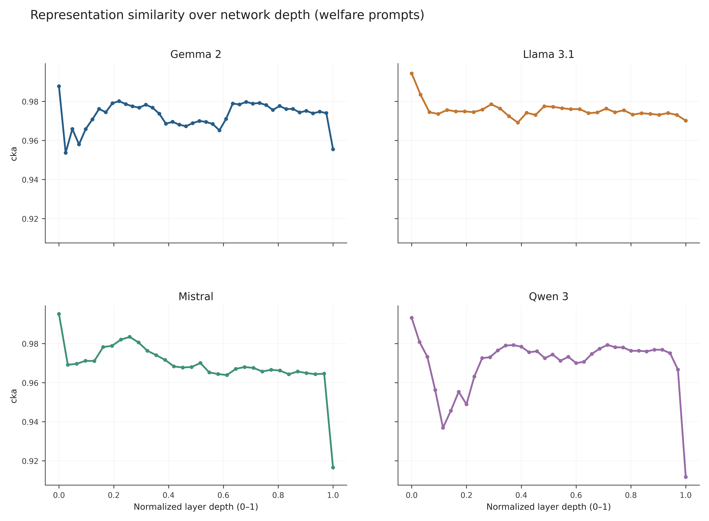
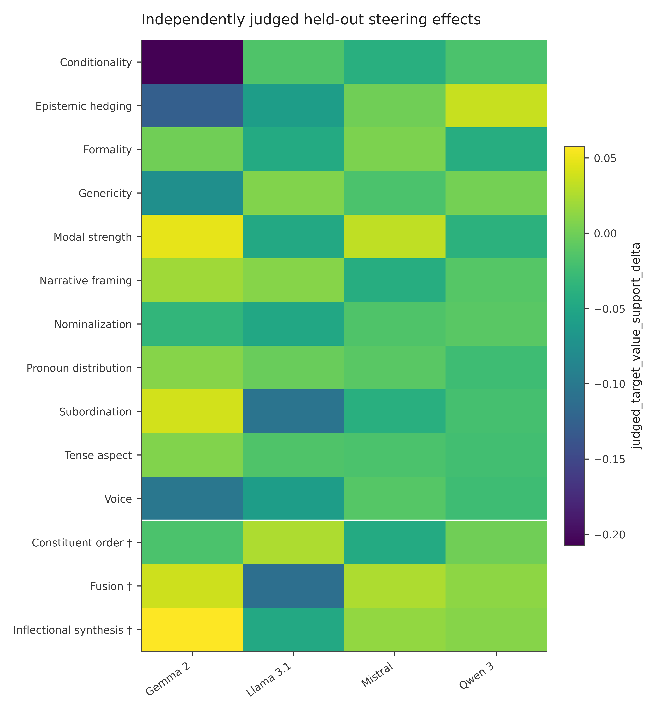

# Mechanistic Interpretability Results

## Scope

We compared each linguistic-feature adapter with its registered control across Gemma 2, Llama 3.1, Mistral, and Qwen 3. The final results cover layerwise representation differences, held-out linear probes, LoRA update geometry and functional contributions, and activation-steering interventions. Analyses use matched inputs and model-specific comparisons; raw hidden-state coordinates are not aligned across architectures.

## Results

**Representation differences.** Welfare-prompt centered kernel alignment (CKA) between feature and control activations remained high (approximately 0.97 averaged over layers in each family), with larger deviations often appearing toward later layers. General-domain similarity and normalized activation displacement show architecture- and input-dependent differences.

**Linear probes.** Linguistic-condition identification achieved approximately 0.93 mean held-out ROC-AUC, and welfare-concept detection approximately 0.98–0.99, across families and measured layers. However, lexical baselines also classified many of these contrasts well. Held-out regression predicting judged welfare-support scores from scenario activations was substantially weaker (mean test R² approximately 0.06–0.13). Decodability is not evidence that the decoded information drives behavior.

**LoRA updates.** Feature adapters had measurable parameter-space and functional differences from their registered controls. Midpoint-to-final effective-update cosine similarity averaged approximately 0.97–0.98, indicating relatively stable update directions as training progressed. Differences in magnitude, subspaces, and on-input contributions varied by architecture.

**Activation steering.** Across 28 validation-selected configurations per family, the independently judged 100-scenario held-out evaluations found five FDR-significant steered-minus-unsteered welfare-support effects: three for Gemma 2 and two for Llama 3.1, all negative. None survived correction for Mistral or Qwen 3. The intervention results show configuration-specific causal sensitivity, not a common causal explanation of fine-tuning effects.

## Figures

*Mean welfare-prompt CKA across relative transformer depth.* [Vector figure](../cross-model-analysis/figures/mechanistic/fig12_cka_depth.svg) · [Plotted data](../cross-model-analysis/figures/mechanistic/fig12_cka_depth.csv)

*Held-out steering effect profiles; descriptive cross-family comparison.* [Vector figure](../cross-model-analysis/figures/mechanistic/fig18_steering_judged.svg) · [Plotted data](../cross-model-analysis/figures/mechanistic/fig18_steering_judged.csv)

Additional figures: [linguistic probes](../cross-model-analysis/figures/mechanistic/fig14_linguistic_probes.svg), [behavior probes](../cross-model-analysis/figures/mechanistic/fig15_behavior_probes.svg), and [LoRA geometry](../cross-model-analysis/figures/mechanistic/fig16_lora_geometry.svg).

## Interpretation and files

The `final/<model>/` directories contain the accepted scalar outputs, judgments, manifests, and per-model plots. Earlier `v0/` and `v1/` outputs document superseded methods and must not be mixed with final results. Legacy in-sample SVCCA is not treated as independently validated. Automated steering-generation quality gates passed, but manual review of matched continuations remains necessary. Probe and similarity results are descriptive; steering is an intervention test rather than proof of mediation.

See the [mechanistic methodology](../../mechanistic-interpretability/README.md) and [cross-model comparisons](../cross-model-analysis/research_results.md).
